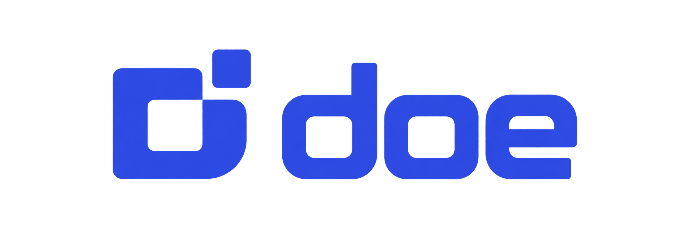
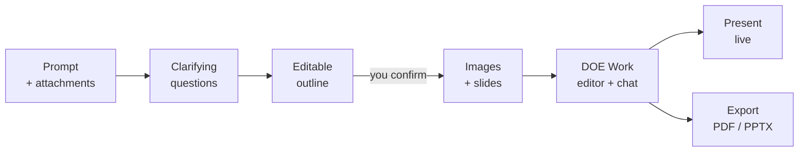
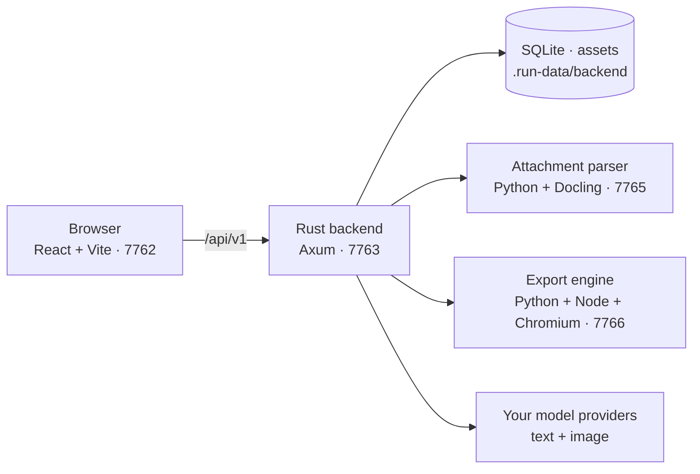

<div align="center">
<a name="readme-top"></a>


<h3>From one prompt to a deck you truly own.</h3>

<p>
The open-source, local-first alternative to Gamma.<br />
Bring your own AI models, co-create slides with an agent, present live,<br />
and export to PDF or genuinely editable PowerPoint.
</p>

**English** · [简体中文](./README.zh-CN.md)

<p>
  <a href="#quick-start"><strong>Quick Start</strong></a> ·
  <a href="#features"><strong>Features</strong></a> ·
  <a href="#design-skills"><strong>Design Skills</strong></a> ·
  <a href="#architecture"><strong>Architecture</strong></a> ·
  <a href="#troubleshooting"><strong>Troubleshooting</strong></a>
</p>

<p>
  <a href="LICENSE"></a>
  
  <a href="https://github.com/wuyoujae/doe/stargazers"></a>
  
  <br />
  
  
  
  
  
  
</p>

</div>

> [!NOTE]
> DOE is in early, active development (`v0.1.0`). It runs as a **local, single-user app on your own machine** — no accounts, no billing, no hosted backend. Model calls go to the providers you configure, using your own credentials.

<details>
<summary><kbd>Table of contents</kbd></summary>

- [Why DOE](#why-doe)
- [Features](#features)
- [How it works](#how-it-works)
- [Design Skills](#design-skills)
- [Models](#models)
- [Quick Start](#quick-start)
- [Configuration](#configuration)
- [Architecture](#architecture)
- [Data, privacy and backups](#data-privacy-and-backups)
- [Development](#development)
- [Troubleshooting](#troubleshooting)
- [Acknowledgements](#acknowledgements)
- [License](#license)

</details>

## Why DOE

Most AI presentation tools hand you a deck you can only keep editing inside their product. DOE is built around the opposite idea: **the work is yours** — the models, the data and the output.

<table>
  <tr>
    <td width="33%" valign="top">
      <h4>Your models, your keys</h4>
      Connect any OpenAI-compatible endpoint — 25 text and 7 image provider presets, or a fully local model through Ollama or LM Studio. Text and image models are configured independently.
    </td>
    <td width="33%" valign="top">
      <h4>Output that stays editable</h4>
      Export PDF with selectable text and PPTX built from native, editable PowerPoint objects with optional embedded fonts — not flattened screenshots.
    </td>
    <td width="33%" valign="top">
      <h4>Local by design</h4>
      Decks, history, attachments and images live in a local data directory. API keys are encrypted with AES-256-GCM, and the backend only listens on loopback.
    </td>
  </tr>
</table>

## Features

<table>
  <tr>
    <td width="50%" valign="top">
      <h4>Prompt to deck, with you in the loop</h4>
      Describe what you need, answer a few clarifying questions, then refine an editable outline. Slides and images are generated only after you explicitly confirm it.
    </td>
    <td width="50%" valign="top">
      <h4>Edit like a designer, iterate like a conversation</h4>
      The DOE Work editor covers themes, components, images, icons and direct text editing. Ask for changes in chat and the agent revises slides in place, keeping slide identity stable.
    </td>
  </tr>
  <tr>
    <td width="50%" valign="top">
      <h4>References the model actually reads</h4>
      Attach PDF, DOCX, PPTX, XLSX, HTML, Markdown, CSV, TXT or JSON — parsed to full Markdown by a dedicated Docling service. PNG, JPEG and WebP are sent as real multimodal input.
    </td>
    <td width="50%" valign="top">
      <h4>Present like a keynote</h4>
      Presenter and audience views with synchronized paging, annotations, laser pointer, black screen and speaker notes. Notes persist and are never sent to the audience.
    </td>
  </tr>
  <tr>
    <td width="50%" valign="top">
      <h4>A fully configurable agent</h4>
      Edit the system prompt, the Outline and Slide schemas and all 18 design Skills under <b>Settings → DOE</b>. Every save is versioned; defaults are always one click away.
    </td>
    <td width="50%" valign="top">
      <h4>Engineered for your data</h4>
      Revision checks prevent silent overwrites across tabs, requests are idempotent, events are persisted before they are shown, and exports freeze an exact revision snapshot.
    </td>
  </tr>
</table>

The interface ships in nine languages: English, 简体中文, 繁體中文, Español, 日本語, 한국어, Français, Deutsch and Português (Brasil).

## How it works



The agent runs on the [Otherone Agent SDK](packages/otherone-agent/) inside the Rust backend. Sessions, tool calls and Q&A history are stored durably, responses stream to the UI, and runs can be cancelled at any time. A server restart never silently re-sends an interrupted generation — it is marked as interrupted and waits for you to retry.

## Design Skills

DOE ships with 18 art-directed design Skills. Each one pairs a theme with native page compositions and complete image prompts, so decks look intentional rather than templated. Enable, disable or rewrite any of them in **Settings → DOE**.

| Skill | Best for |
| --- | --- |
| **Atelier Editorial** | Restaurants, travel, craft and exhibitions |
| **Aurora Product** | Digital products and forward-looking product narratives |
| **Blueprint Lab** | Engineering explanations, research reviews and technical planning |
| **Botanical Journal** | Field research, gardens, ecology and plant-based products |
| **Citrus Paper** | Warm learning, community and practical product stories |
| **Coastal Escape** | Travel, retreats and hospitality |
| **Cobalt Current** | Culture programs, bold launches and public events |
| **Copper Archive** | Heritage, institutional history, collections and archives |
| **Ink & Vermilion** | Contemporary editorial, object and material stories |
| **Ledger Investigation** | Investigative reports, financial reviews and evidence-led stories |
| **McKinsey-inspired** | Executive strategy, board reviews and business cases |
| **Noir Luxe** | Premium hospitality, considered launches and craftsmanship |
| **Obsidian Prism** | Precise product and creative-technology stories |
| **Rose Gallery** | Exhibitions, portfolios and fashion culture |
| **Sage Wellness** | Restorative spaces, wellbeing education and community care |
| **Sunburst Campaign** | Launches, community campaigns and celebrations |
| **Swiss Signal** | Announcements, operating reviews and decision documents |
| **Terracotta Studio** | Architecture, interiors, ceramics and maker portfolios |

## Models

| Kind | Protocol | Presets |
| --- | --- | --- |
| **Text** | OpenAI-style Chat Completions **with tool calling** (vision required for image attachments) | OpenAI, Claude, Google Gemini, DeepSeek, OpenRouter, xAI, Mistral, Groq, Together AI, Fireworks AI, Cerebras, SambaNova, SiliconFlow, Alibaba Cloud (Beijing / Singapore), Moonshot · Kimi, Z.AI, MiniMax, NVIDIA NIM, Novita AI, Hugging Face, Volcengine · Doubao, BytePlus ModelArk, Ollama, LM Studio |
| **Image** | OpenAI-style Images Generations | OpenAI, Google Gemini, xAI, Together AI, Z.AI, Volcengine · Doubao, BytePlus ModelArk |

Any other compatible service works through a **Custom** endpoint. Presets only fill in the official Base URL — they never pick a model for you or imply that every model supports every parameter. The full catalog lives in [`packages/model-catalog/providers.json`](packages/model-catalog/providers.json).

## Quick Start

### Prerequisites

| Dependency | Requirement |
| --- | --- |
| Node.js | ≥ 22.19.0 |
| npm | 11.6.2 |
| Rust / Cargo | ≥ 1.94, plus the platform's native build tools |
| Python | 3.12 — the parser and the export engine each use their own virtual environment |
| Chromium | Installed through the Playwright version locked by the export engine |

### 1. Clone

```sh
git clone https://github.com/wuyoujae/doe.git
cd doe
```

SSH works too: `git@github.com:wuyoujae/doe.git`. The repository is named `doe`; inside the app the product is currently branded **Yrkie**. All commands below run from the repository root.

### 2. Install dependencies

<details open>
<summary><b>Windows (PowerShell)</b></summary>

```powershell
npm ci

py -3.12 -m venv backend/file-parser/.venv
& .\backend\file-parser\.venv\Scripts\python.exe -m pip install --require-hashes -r backend/file-parser/requirements.lock
& .\backend\file-parser\.venv\Scripts\python.exe -m pip install --no-deps -e backend/file-parser

py -3.12 -m venv packages/doe/packages/doe-export/python/.venv
& .\packages\doe\packages\doe-export\python\.venv\Scripts\python.exe -m pip install --require-hashes -r packages/doe/packages/doe-export/python/requirements.lock
npm ci --prefix packages/doe/packages/doe-export/python
node packages/doe/packages/doe-export/python/node_modules/playwright-core/cli.js install chromium
```

Requires the MSVC C++ Build Tools for Rust linking. Without the Python Launcher, confirm `python --version` reports 3.12 and replace `py -3.12` with `python`. Neither virtual environment should inherit system packages; there is no need to activate them or change the PowerShell execution policy.

</details>

<details>
<summary><b>macOS / Linux</b></summary>

```sh
npm ci

python3.12 -m venv backend/file-parser/.venv
backend/file-parser/.venv/bin/python -m pip install --require-hashes -r backend/file-parser/requirements.lock
backend/file-parser/.venv/bin/python -m pip install --no-deps -e backend/file-parser

python3.12 -m venv packages/doe/packages/doe-export/python/.venv
packages/doe/packages/doe-export/python/.venv/bin/python -m pip install --require-hashes -r packages/doe/packages/doe-export/python/requirements.lock
npm ci --prefix packages/doe/packages/doe-export/python
node packages/doe/packages/doe-export/python/node_modules/playwright-core/cli.js install chromium
```

macOS needs the Command Line Developer Tools; Linux needs C/C++ compilers and linkers. If Chromium is missing Linux system libraries, install them with the locked CLI (may require administrator rights):

```sh
node packages/doe/packages/doe-export/python/node_modules/playwright-core/cli.js install-deps chromium
```

</details>

> [!IMPORTANT]
> Installing dependencies, the browser and the parser models requires network access. Python 3.13 cannot replace the 3.12 required by the parser, and **both** npm installs (root and export engine) are required.

### 3. Run

```sh
npm run dev
```

Open **<http://127.0.0.1:7762/create>**. The launcher manages four services on fixed ports — they never switch automatically, so stop any existing instance first. Keep the terminal running and press `Ctrl+C` to stop.

| Service | Port | Health check |
| --- | --- | --- |
| Frontend (Vite) | `7762` | — |
| Backend (Rust / Axum) | `7763` | [`/api/v1/health`](http://127.0.0.1:7763/api/v1/health) |
| Attachment parser (Python / Docling) | `7765` | [`/readyz`](http://127.0.0.1:7765/readyz) |
| Export engine (Python / Node / Chromium) | `7766` | — |

The launcher waits for the export engine to warm up, but the first run also downloads the parser models — a frontend that loads does not mean document parsing is ready. To pre-download them, run `docling-tools models download layout tableformer rapidocr` from the parser virtual environment (on Windows: `.venv/Scripts/docling-tools.exe`). Never point multiple instances at the same data directory.

### 4. Connect your models

1. Open **Settings → Models** (top right) and configure **text** and **image** separately: model ID, Base URL and API key. Choosing a provider preset fills in the Base URL.
2. Use the API root as Base URL — without the trailing `/chat/completions` or `/images/generations`.
3. Expand **Options** for context, reasoning, sampling, output and timeout parameters. Only use fields your provider and model actually support.
4. Optionally tune the prompt, schemas and Skills under **Settings → DOE**. Edits and restored defaults take effect after you save.

> [!TIP]
> Saving settings is a local operation — it does not verify remote authentication or model capabilities. The first real request is the true test. Model calls may incur provider charges.

API keys are encrypted by the backend and never returned in plain text. Leaving an existing key field empty keeps it; clearing a key is an explicit action.

**Attachment limits:** documents up to 30 MiB, 500 pages and 2,000,000 characters; images up to 20 MiB; at most 8 attachments per message. Your model's context window may impose tighter limits. See the [parser guide](backend/file-parser/README.md) for formats and boundaries.

## Configuration

No `.env` file is required, and the launcher does not read one. Set these variables before starting when you need them — and keep installation and runtime values consistent.

| Variable | Default | Purpose |
| --- | --- | --- |
| `YRKIE_DATA_DIR` | `.run-data/backend` | Data directory for the database, master key, assets and exports. Keep custom locations outside the repository or explicitly ignored. |
| `YRKIE_PARSER_PYTHON` | parser `.venv` | Python interpreter for the attachment parser |
| `YRKIE_EXPORT_PYTHON` | export `.venv` | Python interpreter for the export engine |
| `PLAYWRIGHT_BROWSERS_PATH` | Playwright default | Browser cache used by the export engine |
| `PLAYWRIGHT_CHROMIUM_EXECUTABLE` | — | Explicit Chromium executable for exports |
| `YRKIE_BACKEND_LISTEN` | `127.0.0.1:7763` | Backend address — IPv4 loopback only |
| `YRKIE_FRONTEND_ORIGINS` | ports `7762` / `7764` on `127.0.0.1` and `localhost` | Allowed local frontend origins, comma-separated |

## Architecture



| Path | Responsibility |
| --- | --- |
| [`frontend/`](frontend/) | Create, Work, settings, chat, attachments, export and playback UI |
| [`backend/`](backend/) | Rust local API, generation host, SQLite, assets, export jobs and playback state |
| [`backend/file-parser/`](backend/file-parser/) | Standalone Python / Docling document parsing service |
| [`packages/doe/`](packages/doe/) | DOE editor, compiler, live playback and PDF / PPTX export core |
| [`packages/otherone-agent/`](packages/otherone-agent/) | AI agent runtime |
| [`packages/model-catalog/`](packages/model-catalog/) | Model provider catalog shared by frontend and backend |
| [`scripts/`](scripts/) | Local service launcher and process management |
| [`licenses/`](licenses/) | Full texts of third-party licenses distributed with the source |

Deeper references: [backend API and data model](backend/README.md) · [export engine](packages/doe/packages/doe-export/README.md) · [attachment parser](backend/file-parser/README.md) · [agent SDK provenance](packages/otherone-agent/SOURCE.md).

## Data, privacy and backups

Decks, history, attachments, generated images, exports and encrypted model settings are stored in `.run-data/backend/` by default. Never commit the data directory or keys to Git.

- **Backups:** stop the services first, then copy the entire data directory — database, master key and assets must come from the same backup. Never back up only the database or delete the master key.
- **Upgrades:** older code cannot open a database with a newer schema, and downgrades are never performed by dropping tables.
- **Legacy drafts:** early drafts stored in browser IndexedDB remain per browser and site; clearing site data removes them.
- **Scope:** the backend listens on loopback only and provides no multi-user authentication, accounts, billing or public sharing — do not reverse-proxy it to the internet. Speaker notes persist; live sessions and annotations end when the service restarts. Audio and video transcription is not supported.

## Development

```sh
npm run check          # TypeScript and Rust type checks
npm run build          # frontend/dist/ and the backend release binary
npm run test:backend   # Rust backend tests
npm run audit:source   # scan tracked and unignored files before publishing
```

The build does not start services, nor does it bundle the Python environments or Chromium into one installer. Preview a production frontend build with `npm run preview --workspace @yrkie/frontend` on port `7764` — it still needs the backend, parser and export services. There is currently no Docker or one-click production deployment.

For a history-free review snapshot before a release:

```sh
node scripts/audit-open-source.mjs --manifest test/release-review/source-manifest.json --snapshot test/release-review/source
```

The snapshot target must not exist yet; local runtime data and Git history are excluded. The audit never prints matched values and does not replace a manual review.

## Troubleshooting

| Symptom | What to check |
| --- | --- |
| The page opens, but attachments keep waiting | Check the parser's `/readyz` and wait for first-time model initialization. Failed attachments need an explicit retry. |
| Export fails to start or cannot find Chromium | Verify the export Python lock, the separate npm install and the Chromium download; on Linux check system libraries. Install and run as the same user and cache. |
| The model returns 401 / 403 or rejects a parameter | Check the Base URL, credentials, model permissions and Options for that text or image model. A successful local save does not mean the remote call works. |
| A port is already in use | Stop the existing instance before starting again. Do not copy runtime data to work around it. |
| Saving a deck reports a revision conflict | Another window saved first. Keep your current input, load the latest version, then decide how to merge. |

## Acknowledgements

DOE stands on the shoulders of excellent open-source work, including the [Otherone Agent SDK](packages/otherone-agent/) (MIT), [Docling](https://github.com/docling-project/docling), [Lucide](https://lucide.dev) (ISC), [python-pptx](https://github.com/scanny/python-pptx) (MIT), [Playwright](https://playwright.dev), and fonts released under the SIL Open Font License and the MiSans license. See [THIRD_PARTY_NOTICES.md](THIRD_PARTY_NOTICES.md) for the complete list.

## License

DOE is released under the [Apache License 2.0](LICENSE). Third-party code, fonts and other resources included in this repository remain under their own licenses, which this license does not replace. When redistributing, keep the [NOTICE](NOTICE) and the [third-party notices](THIRD_PARTY_NOTICES.md).

<div align="right">

[Back to top](#readme-top)

</div>
