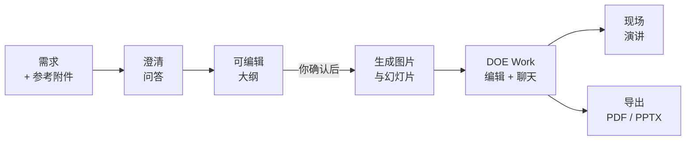
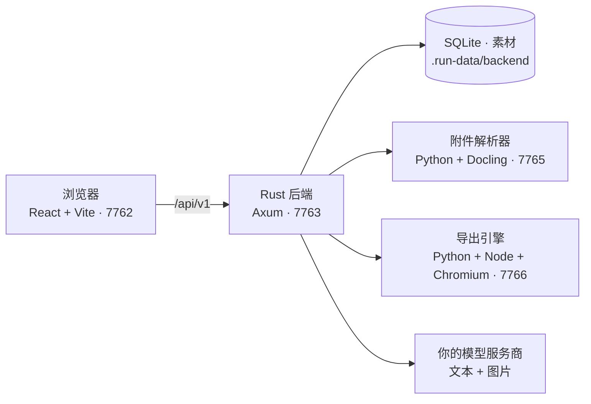

<div align="center">
<a name="readme-top"></a>


<h3>一句话开始，得到一份真正属于你的演示文稿。</h3>

<p>
开源、本地优先的 Gamma 替代品。<br />
接入你自己的 AI 模型，与 Agent 一起创作幻灯片，现场演讲，<br />
或导出为 PDF 与真正可编辑的 PowerPoint。
</p>

<p>
  <a href="https://yrkie.com"><strong>Yrkie</strong></a> 基于 DOE 构建。<br />
  无需本地部署，即可在线体验 DOE 的功能。
</p>

[English](./README.md) · **简体中文**

<p>
  <a href="#快速开始"><strong>快速开始</strong></a> ·
  <a href="#核心功能"><strong>核心功能</strong></a> ·
  <a href="#设计-skills"><strong>设计 Skills</strong></a> ·
  <a href="#架构"><strong>架构</strong></a> ·
  <a href="#常见问题"><strong>常见问题</strong></a>
</p>

<p>
  <a href="LICENSE"></a>
  
  <a href="https://github.com/wuyoujae/doe/stargazers"></a>
  
  <br />
  
  
  
  
  
  
</p>

</div>

> [!NOTE]
> DOE 处于早期快速迭代阶段（`v0.1.0`），目前以**本机单用户应用**的形式运行：没有账户、没有计费，也没有托管后端。模型调用直接发往你配置的服务商，使用你自己的凭据。

<details>
<summary><kbd>目录</kbd></summary>

- [为什么选择 DOE](#为什么选择-doe)
- [核心功能](#核心功能)
- [工作流程](#工作流程)
- [设计 Skills](#设计-skills)
- [模型支持](#模型支持)
- [快速开始](#快速开始)
- [环境变量](#环境变量)
- [架构](#架构)
- [数据、隐私与备份](#数据隐私与备份)
- [开发](#开发)
- [常见问题](#常见问题)
- [致谢](#致谢)
- [许可证](#许可证)

</details>

## 为什么选择 DOE

大多数 AI 演示工具生成的文稿只能留在它们自己的产品里继续编辑。DOE 的出发点正好相反：**模型、数据和成品，都归你所有。**

<table>
  <tr>
    <td width="33%" valign="top">
      <h4>你的模型，你的密钥</h4>
      接入任意 OpenAI 兼容端点：内置 25 个文本、7 个图片服务商预设，也可以通过 Ollama 或 LM Studio 使用完全本地的模型。文本与图片模型独立配置。
    </td>
    <td width="33%" valign="top">
      <h4>成品始终可编辑</h4>
      PDF 保留可选中的文本；PPTX 由原生、可编辑的 PowerPoint 对象构成，并可嵌入字体，而不是一张张截图。
    </td>
    <td width="33%" valign="top">
      <h4>本地优先</h4>
      文稿、历史、附件与图片保存在本机数据目录。API key 使用 AES-256-GCM 加密，后端只监听本机回环地址。
    </td>
  </tr>
</table>

## 核心功能

<table>
  <tr>
    <td width="50%" valign="top">
      <h4>从一句话到整套文稿，每一步由你把关</h4>
      描述需求、回答几个澄清问题，再打磨一份可编辑的大纲。只有在你明确确认大纲之后，才会开始生成图片和幻灯片。
    </td>
    <td width="50%" valign="top">
      <h4>像设计师一样编辑，像对话一样迭代</h4>
      DOE Work 编辑器支持主题、组件、图片、图标和文字直接编辑。在聊天里提出修改，Agent 会原位修订幻灯片，页面身份保持稳定。
    </td>
  </tr>
  <tr>
    <td width="50%" valign="top">
      <h4>模型真正读得懂的参考资料</h4>
      上传 PDF、DOCX、PPTX、XLSX、HTML、Markdown、CSV、TXT 或 JSON，由独立的 Docling 服务完整解析为 Markdown；PNG、JPEG、WebP 作为真实的多模态输入发送给模型。
    </td>
    <td width="50%" valign="top">
      <h4>发布会级别的演讲体验</h4>
      演讲者与观众双视图，支持同步翻页、批注、激光笔、黑屏和演讲备注。备注持久保存，且永远不会发送给观众端。
    </td>
  </tr>
  <tr>
    <td width="50%" valign="top">
      <h4>完全可配置的 Agent</h4>
      在 <b>设置 → DOE 配置</b> 中编辑系统提示词、大纲与幻灯片两份 Schema，以及全部 18 个设计 Skills。每次保存都有版本记录，随时一键恢复默认。
    </td>
    <td width="50%" valign="top">
      <h4>为数据安全而设计</h4>
      版本校验防止多标签页互相覆盖；请求幂等；运行事件先落库再展示；导出时冻结精确的版本快照，后续编辑不会影响已提交的导出。
    </td>
  </tr>
</table>

界面支持九种语言：English、简体中文、繁體中文、Español、日本語、한국어、Français、Deutsch 与 Português (Brasil)。

## 工作流程



Agent 由 Rust 后端内的 [Otherone Agent SDK](packages/otherone-agent/) 执行。会话、工具调用与问答记录持久保存，响应流式呈现，运行可随时取消。服务重启不会悄悄重发中断的生成任务，而是将其标记为已中断，等待你显式重试。

## 设计 Skills

DOE 内置 18 个经过艺术指导的设计 Skills。每个 Skill 都配有专属主题、原生页面构图和完整的图片提示词，让文稿看起来是精心设计的，而不是套模板。你可以在 **设置 → DOE 配置** 中启用、停用或重写任意一个。

| Skill | 适用场景 |
| --- | --- |
| **Atelier Editorial** | 餐饮、旅行、手工艺与展览 |
| **Aurora Product** | 数字产品与面向未来的产品叙事 |
| **Blueprint Lab** | 工程讲解、研究评审与技术规划 |
| **Botanical Journal** | 田野研究、园艺、生态教育与植物类产品 |
| **Citrus Paper** | 温暖的学习、社区与实用产品故事 |
| **Coastal Escape** | 旅行、度假与酒店服务 |
| **Cobalt Current** | 文化项目、大胆的发布与公共活动 |
| **Copper Archive** | 品牌传承、机构历史、馆藏与档案 |
| **Ink & Vermilion** | 当代编辑风格、器物与材料故事 |
| **Ledger Investigation** | 调查报告、财务回顾与证据驱动的叙事 |
| **McKinsey-inspired** | 高管战略、董事会汇报与商业论证 |
| **Noir Luxe** | 高端酒店、精品发布与匠心工艺 |
| **Obsidian Prism** | 精准的产品与创意科技故事 |
| **Rose Gallery** | 展览、作品集与时尚文化 |
| **Sage Wellness** | 疗愈空间、健康科普与社区关怀 |
| **Sunburst Campaign** | 新品发布、社区活动与庆典 |
| **Swiss Signal** | 公告、经营回顾与决策文档 |
| **Terracotta Studio** | 建筑、室内、陶艺与创作者作品集 |

## 模型支持

| 类型 | 协议 | 服务商预设 |
| --- | --- | --- |
| **文本** | OpenAI 风格 Chat Completions，**必须支持工具调用**（上传参考图片还需支持视觉） | OpenAI、Claude、Google Gemini、DeepSeek、OpenRouter、xAI、Mistral、Groq、Together AI、Fireworks AI、Cerebras、SambaNova、硅基流动 SiliconFlow、阿里云百炼（北京 / 新加坡）、Moonshot · Kimi、智谱 Z.AI、MiniMax、NVIDIA NIM、Novita AI、Hugging Face、火山方舟 · 豆包、BytePlus ModelArk、Ollama、LM Studio |
| **图片** | OpenAI 风格 Images Generations | OpenAI、Google Gemini、xAI、Together AI、智谱 Z.AI、火山方舟 · 豆包、BytePlus ModelArk |

其他兼容服务可通过 **Custom（自定义）** 端点接入。预设只会填写官方 Base URL，不会替你选择模型，也不代表每个模型都支持所有参数。完整目录见 [`packages/model-catalog/providers.json`](packages/model-catalog/providers.json)。

## 快速开始

如果你不想自己配置，可以复制下面的 prompt 发送至你的 Agent 工具：

```text
将项目 https://github.com/wuyoujae/doe.git 克隆到本地，配置其运行环境，最后将它运行起来。
```

### 环境要求

| 依赖 | 要求 |
| --- | --- |
| Node.js | ≥ 22.19.0 |
| npm | 11.6.2 |
| Rust / Cargo | ≥ 1.94，以及平台所需的编译工具 |
| Python | 3.12；解析器和导出引擎各使用独立虚拟环境 |
| Chromium | 使用导出引擎锁定版本的 Playwright 安装 |

### 1. 获取源码

```sh
git clone https://github.com/wuyoujae/doe.git
cd doe
```

也可以使用 SSH：`git@github.com:wuyoujae/doe.git`（需已配置 GitHub SSH 访问）。仓库名为 `doe`，应用内的产品名称目前仍为 **Yrkie**。以下命令均在项目根目录执行。

### 2. 安装依赖

<details open>
<summary><b>Windows（PowerShell）</b></summary>

```powershell
npm ci

py -3.12 -m venv backend/file-parser/.venv
& .\backend\file-parser\.venv\Scripts\python.exe -m pip install --require-hashes -r backend/file-parser/requirements.lock
& .\backend\file-parser\.venv\Scripts\python.exe -m pip install --no-deps -e backend/file-parser

py -3.12 -m venv packages/doe/packages/doe-export/python/.venv
& .\packages\doe\packages\doe-export\python\.venv\Scripts\python.exe -m pip install --require-hashes -r packages/doe/packages/doe-export/python/requirements.lock
npm ci --prefix packages/doe/packages/doe-export/python
node packages/doe/packages/doe-export/python/node_modules/playwright-core/cli.js install chromium
```

Rust 链接需要 MSVC C++ Build Tools。若没有 Python Launcher，请先确认 `python --version` 为 3.12，再将 `py -3.12` 替换为 `python`。两个虚拟环境都不要继承系统包，也无需激活或修改 PowerShell 执行策略。

</details>

<details>
<summary><b>macOS / Linux</b></summary>

```sh
npm ci

python3.12 -m venv backend/file-parser/.venv
backend/file-parser/.venv/bin/python -m pip install --require-hashes -r backend/file-parser/requirements.lock
backend/file-parser/.venv/bin/python -m pip install --no-deps -e backend/file-parser

python3.12 -m venv packages/doe/packages/doe-export/python/.venv
packages/doe/packages/doe-export/python/.venv/bin/python -m pip install --require-hashes -r packages/doe/packages/doe-export/python/requirements.lock
npm ci --prefix packages/doe/packages/doe-export/python
node packages/doe/packages/doe-export/python/node_modules/playwright-core/cli.js install chromium
```

macOS 需要命令行开发工具，Linux 需要 C/C++ 编译和链接工具。如果 Chromium 缺少 Linux 系统库，请使用锁定版本的 CLI 安装（可能需要管理员权限）：

```sh
node packages/doe/packages/doe-export/python/node_modules/playwright-core/cli.js install-deps chromium
```

</details>

> [!IMPORTANT]
> 安装依赖、浏览器及解析模型都需要联网。Python 3.13 不能替代解析器要求的 3.12；根目录与导出引擎的**两次** npm 安装都必须完成。

### 3. 启动

```sh
npm run dev
```

打开 **<http://127.0.0.1:7762/create>**。启动器会管理四个固定端口的服务，端口不会自动切换，请先停止已有实例。保持终端运行，按 `Ctrl+C` 停止。

| 服务 | 端口 | 健康检查 |
| --- | --- | --- |
| 前端（Vite） | `7762` | — |
| 后端（Rust / Axum） | `7763` | [`/api/v1/health`](http://127.0.0.1:7763/api/v1/health) |
| 附件解析器（Python / Docling） | `7765` | [`/readyz`](http://127.0.0.1:7765/readyz) |
| 导出引擎（Python / Node / Chromium） | `7766` | — |

启动器会等待导出引擎预热，但首次运行还需下载解析模型：前端能打开，不代表文档解析已经就绪。如需提前下载，可在解析器虚拟环境中运行 `docling-tools models download layout tableformer rapidocr`（Windows 入口为 `.venv/Scripts/docling-tools.exe`）。不要让多个实例同时操作同一个数据目录。

### 4. 接入你的模型

1. 打开右上角 **设置 → 模型**，分别配置**文本**和**图片**：模型 ID、Base URL 和 API key。选择服务商预设会自动填写 Base URL。
2. Base URL 填写接口根地址，不要带上 `/chat/completions` 或 `/images/generations`。
3. 展开 **选项** 可调整上下文、推理、采样、输出和超时等参数；只使用服务商和模型实际支持的字段。
4. 如有需要，在 **设置 → DOE 配置** 中调整提示词、Schema 与 Skills。修改或恢复默认后，需要显式保存才会生效。

> [!TIP]
> 保存设置只是本地操作，不会验证远端鉴权或模型能力，第一次真实调用才是真正的检验。模型请求可能产生服务商费用。

API key 由后端加密保存，读取设置时不会返回明文。已有密钥的输入框留空表示保留；清除密钥必须显式操作。

**附件上限：** 文档最大 30 MiB、500 页、2,000,000 正文字符；图片最大 20 MiB；每条消息最多 8 个附件。模型上下文窗口可能带来更严格的限制。格式与服务边界详见[解析器说明](backend/file-parser/README.md)。

## 环境变量

默认不需要 `.env`，启动器也不会读取它。需要时在启动前设置以下变量，并保持安装与运行时的配置一致。

| 变量 | 默认值 | 用途 |
| --- | --- | --- |
| `YRKIE_DATA_DIR` | `.run-data/backend` | 数据库、主密钥、素材与导出文件所在目录。自定义目录应放在仓库外，或明确加入忽略规则。 |
| `YRKIE_PARSER_PYTHON` | 解析器 `.venv` | 附件解析器使用的 Python 解释器 |
| `YRKIE_EXPORT_PYTHON` | 导出引擎 `.venv` | 导出引擎使用的 Python 解释器 |
| `PLAYWRIGHT_BROWSERS_PATH` | Playwright 默认 | 导出引擎使用的浏览器缓存 |
| `PLAYWRIGHT_CHROMIUM_EXECUTABLE` | — | 显式指定导出用的 Chromium 可执行文件 |
| `YRKIE_BACKEND_LISTEN` | `127.0.0.1:7763` | 后端监听地址，仅允许 IPv4 回环地址 |
| `YRKIE_FRONTEND_ORIGINS` | `127.0.0.1` 与 `localhost` 的 `7762` / `7764` 端口 | 允许的本机前端 Origin，逗号分隔 |

## 架构



| 目录 | 职责 |
| --- | --- |
| [`frontend/`](frontend/) | Create、Work、设置、对话、附件及导出 / 播放界面 |
| [`backend/`](backend/) | Rust 本地 API、生成宿主、SQLite、素材、导出任务与播放状态 |
| [`backend/file-parser/`](backend/file-parser/) | 独立的 Python / Docling 文档解析服务 |
| [`packages/doe/`](packages/doe/) | DOE 编辑器、编译器、正式播放和 PDF / PPTX 导出核心 |
| [`packages/otherone-agent/`](packages/otherone-agent/) | AI Agent 执行框架 |
| [`packages/model-catalog/`](packages/model-catalog/) | 前后端共享的模型服务商目录 |
| [`scripts/`](scripts/) | 本地服务启动与进程管理 |
| [`licenses/`](licenses/) | 随源码分发的第三方许可原文 |

深入阅读：[后端 API 与数据模型](backend/README.md) · [导出引擎](packages/doe/packages/doe-export/README.md) · [附件解析器](backend/file-parser/README.md) · [Agent SDK 来源说明](packages/otherone-agent/SOURCE.md)

## 数据、隐私与备份

文稿、历史、附件、生成图片、导出文件和加密的模型配置默认保存在 `.run-data/backend/`。不要把数据目录或密钥提交到 Git。

- **备份：** 先停止服务，再完整复制整个数据目录。数据库、主密钥与素材必须来自同一套备份；不要只备份数据库，也不要删除主密钥。
- **升级：** 旧版本代码无法打开更高 schema 版本的数据库，也不会通过删表来降级。
- **旧草稿：** 早期保存在浏览器 IndexedDB 中的草稿按浏览器和站点存放，清除站点数据会将其删除。
- **边界：** 后端只监听本机，不提供公网多用户认证、账户、计费或公开分享，请不要把它反向代理到公网。演讲备注持久保存；临时演讲现场与批注随服务重启结束。暂不支持音视频转录。

## 开发

```sh
npm run check          # TypeScript 与 Rust 类型检查
npm run build          # 生成 frontend/dist/ 与后端 release 二进制
npm run test:backend   # Rust 后端测试
npm run audit:source   # 发布前检查已跟踪及未忽略的文件
```

构建不会启动服务，也不会把 Python 环境和 Chromium 打包成单一安装包。前端预览命令为 `npm run preview --workspace @yrkie/frontend`，使用端口 `7764`，仍需要后端及解析、导出服务。目前没有 Docker 或一键生产部署入口。

发布前如需生成不含 Git 历史的审核快照：

```sh
node scripts/audit-open-source.mjs --manifest test/release-review/source-manifest.json --snapshot test/release-review/source
```

快照目标目录必须尚不存在，快照会排除本机运行数据与 Git 历史。检查脚本不会输出命中值，也不能替代人工审阅。

## 常见问题

| 现象 | 检查方向 |
| --- | --- |
| 页面能打开，但附件一直在等待 | 检查解析器 `/readyz`，等待首次模型初始化完成；失败的附件需要显式重试。 |
| 导出启动失败或找不到 Chromium | 核对导出引擎的 Python 锁文件、独立 npm 安装与 Chromium 下载；Linux 还需检查系统库。安装与运行请使用同一用户和缓存。 |
| 模型返回 401 / 403 或不支持某个参数 | 检查对应文本 / 图片模型的地址、凭据、模型权限和选项。本地保存成功不代表远端可用。 |
| 端口被占用 | 先停止已有实例再启动，不要通过复制运行数据来绕过。 |
| 保存文稿时提示版本冲突 | 其他窗口已先保存。保留当前输入，读取最新内容后再决定如何合并。 |

## 致谢

DOE 建立在众多优秀的开源项目之上，包括 [Otherone Agent SDK](packages/otherone-agent/)（MIT）、[Docling](https://github.com/docling-project/docling)、[Lucide](https://lucide.dev)（ISC）、[python-pptx](https://github.com/scanny/python-pptx)（MIT）、[Playwright](https://playwright.dev)，以及采用 SIL Open Font License 与 MiSans 许可的字体。完整清单见 [THIRD_PARTY_NOTICES.md](THIRD_PARTY_NOTICES.md)。

## 许可证

DOE 采用 [Apache License 2.0](LICENSE) 开源。仓库中保留的第三方代码、字体及其他资源遵循各自的许可，本项目许可不取代这些许可。分发时请保留 [NOTICE](NOTICE) 及[第三方声明](THIRD_PARTY_NOTICES.md)。

<div align="right">

[返回顶部](#readme-top)

</div>
